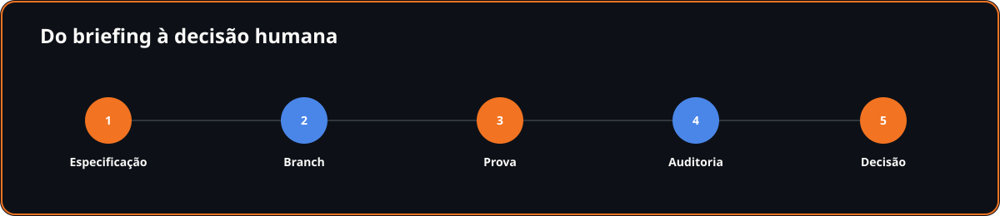
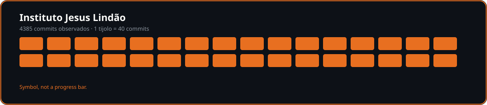

<!-- projects-fingerprint:422a99253396cf96 -->

# Johnata Moreira

**Full-stack / Product Engineer**

AI-assisted development, with gates, evidence and audit.

[
[Site](https://johnatamoreira.com.br) · [LinkedIn](https://www.linkedin.com/in/eujohnatamoreira) · [Mishyo](https://mishyo.com) · [WhatsApp](https://wa.me/5531975693311) · [E-mail](mailto:contato@johnatamoreira.com.br)
]

---

## About me

I am Johnata Moreira, based in Belo Horizonte, Brazil. I build digital products, orchestrate AI agents and verify every delivery with explicit criteria. My family and Instituto Jesus Lindão give the work its purpose.

## Mishyo

### Mishyo
**Em lançamento**

An app for families to preserve photos, videos, stories and their shared timeline.

`TypeScript` `Next.js` `Supabase` `Tailwind` `Playwright`

[Conhecer →](https://mishyo.com)

## J&JL Dashboard

### Painel J&JL
**Em produção**

A dashboard for traffic management, leads and campaign results for real-estate agents.

`TypeScript` `Next.js` `Supabase` `Tailwind`

[Conhecer →](https://painel.grupojjl.com.br)

## How I work

I specify before execution, keep work on a branch, test against staging, review security and only then make the human release decision. AI writes much of the code; I orchestrate, verify and own the decision.

## Instituto Jesus Lindão

A school where no child is excluded for being unable to pay. A hospital where dignity does not depend on a bank balance.

The goal is a perpetual **R$ 2 billion** fund. Every sustainable product is a brick in that construction.

## Activity

## Contact

[
[Site](https://johnatamoreira.com.br) · [LinkedIn](https://www.linkedin.com/in/eujohnatamoreira) · [Mishyo](https://mishyo.com) · [WhatsApp](https://wa.me/5531975693311) · [E-mail](mailto:contato@johnatamoreira.com.br)
]

Building with purpose, one session at a time.

When the deploy works

