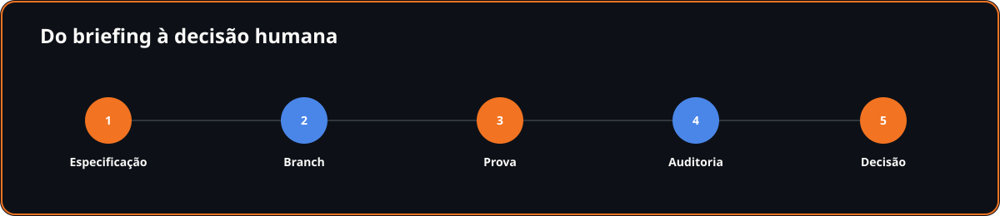

<!-- projects-fingerprint:422a99253396cf96 -->

# Johnata Moreira

**Full-stack / Product Engineer**

Desenvolvimento assistido por IA, com gates, prova e auditoria.

[
[Site](https://johnatamoreira.com.br) · [LinkedIn](https://www.linkedin.com/in/eujohnatamoreira) · [Mishyo](https://mishyo.com) · [WhatsApp](https://wa.me/5531975693311) · [E-mail](mailto:contato@johnatamoreira.com.br)
]

---

## Quem sou

Sou Johnata Moreira, de Belo Horizonte. Construo produtos digitais, orquestro agentes de IA e verifico cada entrega com critérios claros. Minha família e o Instituto Jesus Lindão dão sentido ao trabalho.

## Mishyo

### Mishyo
**Em lançamento**

Aplicativo para famílias preservarem fotos, vídeos, histórias e a linha do tempo da vida juntos.

`TypeScript` `Next.js` `Supabase` `Tailwind` `Playwright`

[Conhecer →](https://mishyo.com)

## Painel J&JL

### Painel J&JL
**Em produção**

Painel para gestão de tráfego, leads e resultados de campanhas para corretores.

`TypeScript` `Next.js` `Supabase` `Tailwind`

[Conhecer →](https://painel.grupojjl.com.br)

## Como eu trabalho

Especifico antes de executar, mantenho o trabalho em branch, testo contra staging, reviso segurança e só então tomo a decisão humana de publicação. A IA escreve grande parte do código; eu orquestro, verifico e assumo a decisão.

## Instituto Jesus Lindão

Uma escola onde nenhuma criança seja excluída por não poder pagar. Um hospital onde a dignidade do atendimento não dependa do saldo na conta.

A meta é um fundo perpétuo de **R$ 2 bilhões**. Cada produto sustentável é um tijolo nessa construção.

## Atividade

## Contato

[
[Site](https://johnatamoreira.com.br) · [LinkedIn](https://www.linkedin.com/in/eujohnatamoreira) · [Mishyo](https://mishyo.com) · [WhatsApp](https://wa.me/5531975693311) · [E-mail](mailto:contato@johnatamoreira.com.br)
]

Construindo com propósito, sessão por sessão.

Quando o deploy dá certo

